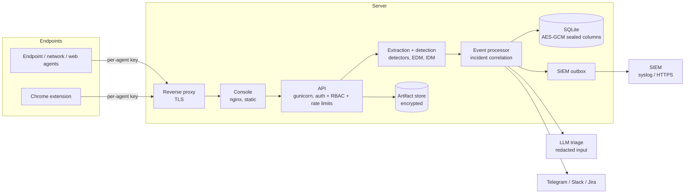

<p align="center"></p>

# Tron — the DLP Agent

Open-source endpoint and web data loss prevention: agents and a Chrome extension detect sensitive data leaving a machine, a Flask API scores and triages it, and a React console gives the SOC one place to investigate.

[](LICENSE)
[](https://www.python.org/)
[](https://react.dev/)

> **Status:** 2.1. Runs in production form (gunicorn, TLS reverse proxy, per-agent keys, encryption at rest). Read [docs/security.md](docs/security.md) for the trust model and its stated limitations before deploying.

## What it does

**Endpoint agents** (`agents/`, Python; macOS, Linux, Windows)
- `endpoint_agent.py`: clipboard scanning, file-upload/watch-folder scanning, USB device detection, network connection and suspicious-process monitoring, shell and browser history scanning
- `network_agent.py`: outbound connections, outbound data volume, listening ports, browser activity
- `web_agent.py`: downloads, browser history, print spool and temp-file scanning
- All agents enroll once, authenticate with their own key, spool detections to an encrypted local queue while the API is unreachable, and accept signed upgrades

**Chrome extension** (`browser-extension/`, Manifest V3)
- Inspects web **pastes** and **file uploads** (file picker and drag-and-drop) before they reach the page
- Local scanning with the same detector library, block / warn / monitor modes, policy sync from the API
- Holds its agent key in the service worker; content scripts never see credentials

**Console** (`siem-console/`, React + Vite)
- Dashboard with live event stream, analytics, events log with event and incident drill-down
- Policies, exceptions, detector library (tune built-ins, add custom detectors), Detection Lab
- Protected Documents: register confidential documents for fingerprint matching
- Fleet view (status, commands, collected artifacts, managed extension settings)
- Platform & Security: security posture, agent key inventory (issue, rotate, revoke), data retention, SIEM forwarding
- Governance: hash-chained audit trail, users, roles, per-permission RBAC

## Detection pipeline

```
content ──► true file type ──► extraction / OCR ──► normalize ──► 53 detectors ──► validators ──► keyword context ──► EDM ──► redaction ──► LLM triage ──► incident + alert
            (magic bytes)      PDF, Office, ODF,     NFKC, strip    (PII, financial,  Luhn+IIN,      proximity                     before any     FP probability,
                               RTF, email, zip/tar,  zero-width,    secrets, health,  Verhoeff,      window                        external call  risk score
                               images (Tesseract)    base64 decode  classification)   mod-97, ...
```

1. **True type and extraction** (`src/extraction.py`): magic bytes pick the parser, so renamed files are still inspected. PDF text via PDFium, with page-level OCR only for scanned pages; Office/OpenDocument including headers, footers, comments, notes and numeric cells; archives and email attachments recursively with zip-bomb limits; encrypted files reported explicitly.
2. **Detection** (`src/detection/`): 53 data identifiers with 20 validators (Luhn + issuer ranges, Verhoeff, ISO 7064 mod 97-10 and mod 11-2, SSN rules, ABA, NHS, CPF, DNI, TFN, GSTIN, JWT), keyword proximity, Unicode/zero-width/base64 evasion handling, and overlap resolution so one value yields one finding. 20 of them cover credentials (GitHub, GitLab, Slack, Stripe, Google, Azure, OpenAI, Anthropic, private keys, credentialed connection strings, entropy-checked generic secrets).
3. **Exact Data Match**: optional hashed index of protected records (for example the customer table); a match needs several fields of the same record, not just something that looks like an SSN.
   **Indexed Document Matching** (`src/detection/idm.py`): register confidential documents in the console; winnowed, keyed shingle fingerprints then detect full copies, reformatted copies and excerpts of about 13 words or more. Only fingerprints are stored.
4. **Policies**: console policies are either custom regexes or references to validated built-in detectors. Files with 10+ identity/financial findings escalate to critical (bulk exposure).
5. **Redaction and LLM triage** (Gemini): every detected value is replaced with `[REDACTED:<TYPE>]` before the prompt is built. The model returns a false-positive probability, risk score and verdict; without an API key the system falls back to "needs review".
6. **Incidents and alerting**: events are correlated per policy threshold and window, stored in SQLite (sensitive columns encrypted), streamed to the console, and forwarded to your SIEM (syslog CEF/JSON, HTTPS webhooks, Splunk HEC). Telegram alerts, Slack and Jira escalation are optional.

The browser extension runs the same detector library (generated from the Python source and parity-tested in CI).

**Measured against the previous version** (details and method in [docs/detection.md](docs/detection.md)):

| | Before | Now |
|---|---|---|
| False positives on 2.1 MB of unseen text (excluding emails) | 2,078 | 3 |
| Text scan, 1 MB | 528 ms | 177 ms |
| 10-page PDF extraction | 149 ms (Docling: 8 s warm) | 12 ms |
| Image OCR | 1.96 s | 0.14 s |
| Install size / peak memory with Docling | 6.3 GB / 2.4 GB | 83 MB / 44 MB |

## Architecture



## Quick start

### Docker Compose (console + API)

```bash
git clone https://github.com/Kathan2004/Tron-the-DLP-Agent.git
cd Tron-the-DLP-Agent
./setup.sh                      # creates .env with generated secrets
docker compose up -d --build    # http://127.0.0.1:8080
docker compose logs tron-api | grep -A3 "one-time admin password"
```

With TLS: `TRON_DOMAIN=dlp.example.com TRON_TRUSTED_PROXIES=2 docker compose --profile tls up -d --build`. Details, backup and monitoring: [docs/deployment.md](docs/deployment.md).

### Local development

```bash
./setup.sh
./start            # API on 127.0.0.1:5001 (dev server) + console on localhost:5173
./start_all.sh     # API + endpoint, network and web agents
```

OCR needs the Tesseract binary (`brew install tesseract` or `apt install tesseract-ocr`). Without it, images and scanned PDFs are reported as not inspected; everything else works.

On first start, if `APP_ADMIN_PASSWORD` is not set, the API prints a one-time admin password and forces a change at first login.

### Agents

```bash
export TRON_AGENT_TOKEN=<enrollment token from the API's .env>
python agents/endpoint_agent.py --api https://dlp.example.com
```

The agent enrolls on first contact and keeps its key in `~/.tron/` (`%LOCALAPPDATA%\Tron\` on Windows). Plain `http://` is only accepted for loopback.

### Chrome extension

1. `chrome://extensions` > enable **Developer mode** > **Load unpacked** > select `browser-extension/` (or use the zip attached to a GitHub Release).
2. For managed fleets, push `apiUrl` and `agentToken` through Chrome enterprise policy (schema: `browser-extension/managed_schema.json`). Policy values override local settings.

### Configuration

| Variable | Required | Description |
|---|---|---|
| `APP_AUTH_SECRET` | Yes | Signs console sessions and stream tickets. If unset, a random per-run secret is used and sessions end on restart. |
| `TRON_AGENT_TOKEN` | Yes | Enrollment token. Agents and the extension exchange it once for their own key. If unset, ingest endpoints are unauthenticated. |
| `TRON_AGENT_AUTH` | Recommended | `strict` once agents are enrolled: only per-agent keys are accepted on ingest. Default `token` (shared token or key). |
| `TRON_DATA_KEY` | Recommended | Base64 32-byte key for encryption at rest. If unset, a key file is created next to the database. |
| `TRON_TRUSTED_PROXIES` | Behind a proxy | Number of proxy hops whose `X-Forwarded-*` headers are trusted (default 0). |
| `APP_ADMIN_EMAIL` / `APP_ADMIN_PASSWORD` | No | Bootstrap admin (only while the user table is empty). |
| `APP_CORS_ORIGINS` | No | Console origins allowed cross-origin. Not needed when console and API share an origin. |
| `TRON_METRICS_TOKEN` | No | Enables `GET /api/metrics` (Prometheus) with this bearer token. |
| `TRON_LOG_FORMAT` / `TRON_LOG_LEVEL` | No | `json` for structured logs; level (default `INFO`). |
| `TRON_UPDATE_PUBKEY` | Agents | Base64 Ed25519 public key for verifying signed upgrades. If unset, the agent refuses remote upgrades. |
| `TELEGRAM_BOT_TOKEN` / `SECURITY_CHAT_ID` | No | Telegram alerts with inline actions. |
| `GOOGLE_GENAI_API_KEY` | No | Gemini LLM triage and the AI rule lab (input is redacted first). |
| `SLACK_WEBHOOK_URL`, `JIRA_SERVER` / `JIRA_USER` / `JIRA_TOKEN` | No | Escalation. |
| `APP_MAX_REQUEST_MB` | No | Maximum request body size (default 75 MB). |
| `TRON_BULK_THRESHOLD` | No | Identity/financial findings in one file that escalate it to critical (default 10). |
| `TRON_EDM_DIR` / `TRON_EDM_KEY` | No | Exact Data Match index directory and HMAC key. |

SIEM destinations and retention periods are configured in the console, not in the environment. Rate limits and the remaining knobs are listed in [docs/deployment.md](docs/deployment.md).

## Security

The full model is in [docs/security.md](docs/security.md). In short:

- **Agents authenticate individually.** Enrollment issues a per-agent key (only its hash is stored); keys rotate and revoke from the console; a key binds every request to its agent, so one agent cannot report as another.
- **Sensitive data is encrypted at rest** with AES-256-GCM: matched values, payload samples, captured files, screenshots, the SIEM queue and stored integration secrets.
- **Nothing sensitive leaves unredacted.** LLM prompts are built from redacted text; SIEM records carry detector names and identities, never matched values. (Exception: the extension's optional AI mode sends image uploads to Gemini for OCR.)
- **The audit log is tamper-evident** (hash chain, verifiable from the console).
- **Console access** uses server-side sessions with revocation, idle timeout, lockout, per-permission RBAC and a rate-limited login. The live stream requires a short-lived ticket.
- **Signed agent upgrades** (Ed25519, key pinned on the agent): a compromised API cannot run code on endpoints.
- **Hardened HTTP surface:** security headers and CSP, opaque errors with request IDs, captured files never rendered as active content, request size caps.
- **No real data is committed.** Databases, artifacts, logs, `.env` and keys are git-ignored.

## Tests

```bash
pip install -r requirements-dev.txt
python -m pytest -q                       # OCR tests skip if tesseract is missing
ruff check . && pip-audit -r requirements.txt
python scripts/benchmark_detection.py     # precision/recall + latency
cd siem-console && npm ci && npm run lint && npm run build
```

CI (`.github/workflows/ci.yml`) runs lint, dependency audits (pip and npm), the tests, the benchmark, the extension parity check, the console build, both image builds with a container health check, a manifest check and a gitleaks history scan. Actions are pinned to commit SHAs. Tagging `vX.Y.Z` publishes the extension zip with checksums as a GitHub Release.

## Documentation

- [docs/deployment.md](docs/deployment.md): topology, TLS, process model, agent key rollout, backup, monitoring
- [docs/security.md](docs/security.md): trust boundaries, encryption, audit chain, limitations
- [docs/api.md](docs/api.md): agent, IDM and platform endpoints
- [docs/detection.md](docs/detection.md): detection design, benchmarks, gap analysis

## Roadmap

- [x] Production WSGI server and TLS deployment
- [x] Per-agent keys with rotation and revocation
- [x] Windows endpoint agent (parser-tested; not yet exercised on a Windows host in CI)
- [x] Encryption at rest and retention policies
- [x] Indexed Document Matching
- [x] SIEM forwarding (syslog CEF/JSON, webhooks, Splunk HEC)
- [x] Extension build published as a GitHub Release asset
- [ ] Client/server database option for multi-process scale-out
- [ ] SSO (OIDC/SAML) and MFA for the console
- [ ] HttpOnly cookie sessions for the console
- [ ] Signed upgrades for Windows agents; agent packaging as OS services
- [ ] Email (SMTP/MTA) and cloud-storage API channels

## Project layout

```
agents/             endpoint, network and web agents
browser-extension/  Chrome MV3 extension
config/             settings
deploy/             Caddyfile for the TLS profile
docs/               deployment, security, API, detection design
siem-console/       React/Vite console, nginx config, Dockerfile
src/                API (api.py, routes_platform.py), bootstrap, security, crypto, agent auth,
                    SIEM forwarder, retention, metrics, database, scanners, Telegram bot
src/detection/      detector library, validators, engine, Exact Data Match, document matching
scripts/            benchmark, extension detector generator, upgrade signing
tests/              pytest suite
wsgi.py             production entry point (gunicorn -c gunicorn.conf.py wsgi:app)
main.py             development entry point
```

## Author

Kathan Somani

## License

[MIT](LICENSE)
